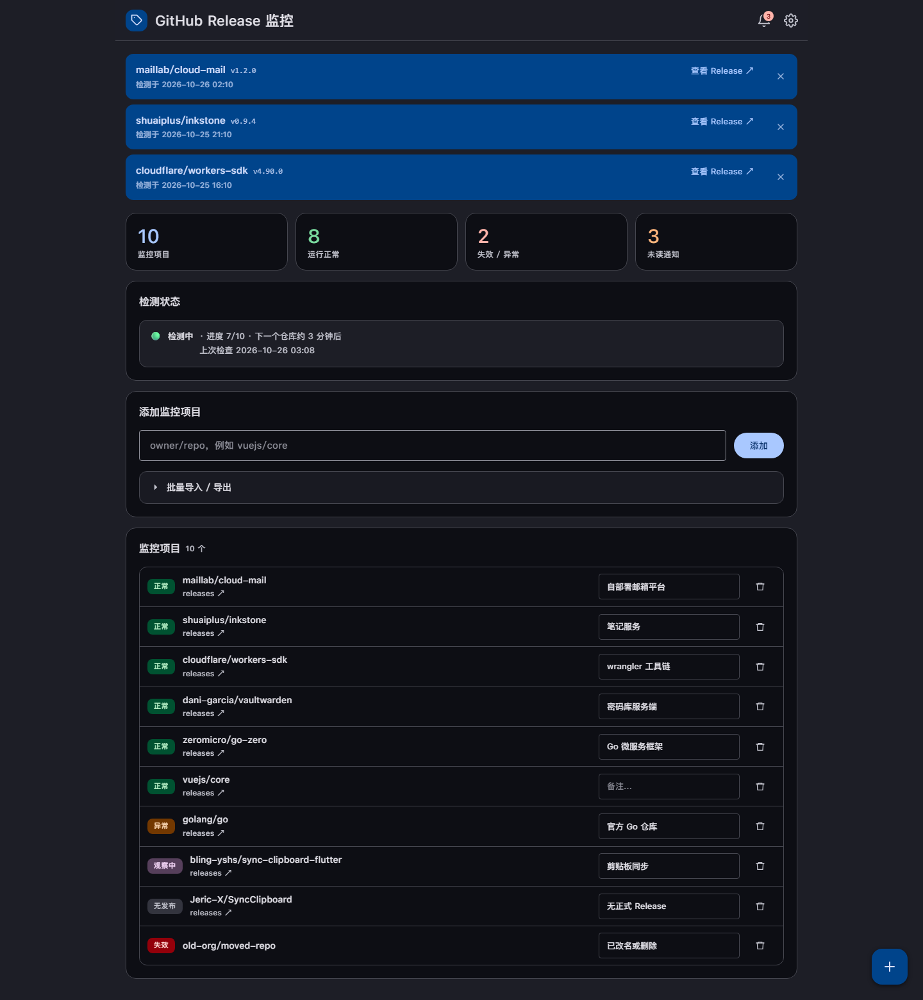
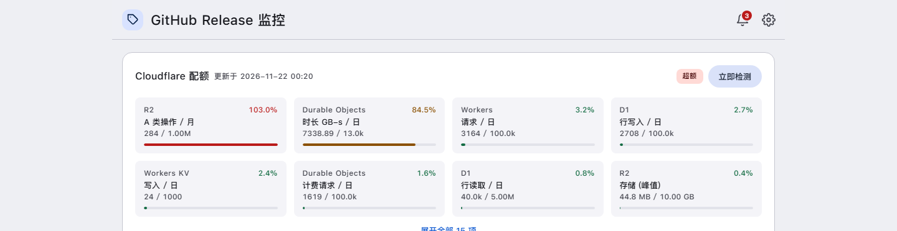

# GitHub Release Monitor

**部署在 Cloudflare Workers 上的 GitHub Release 监控与通知服务**

盯住你关心的仓库，发新版就往微信 / 钉钉 / Telegram / 任意 Webhook 推一条。

---

## 这是什么

一个单文件 Cloudflare Worker。按你设定的节奏轮询仓库的最新 Release，tag 变了就推送，同时记进站内通知中心。数据存 D1，重启不丢，换设备状态一致。免费额度足够个人用。

## 特性

- **单文件、运行时零依赖**：Worker 本体只有 `index.js`，没有打包和构建步骤，HTML/CSS/JS 全部内联在同一个文件里
- **断点续查**：状态机 + D1 持久化，重启或重部署不丢进度，不重复推送
- **省 API 配额**：ETag 条件请求，命中 304 不消耗 GitHub 限额
- **站内通知中心**：通知存服务端，关掉即删除，多端同步
- **自定义通知**：标题与正文模板可改，支持任意 HTTP 端点
- **免打扰时段**：指定时段不推送，期间的更新留到结束后补发
- **批量导入导出**：TXT 一行一个，可带备注
- **失效判定**：区分「仓库没了」「没有 Release」和「临时失败」，不误报
- **可选配额面板**：顺带监控自己 Cloudflare 账号的用量，超 80% 预警
- **Material Design 3 界面**：明暗双主题，自动跟随系统

## 界面

| 浅色 | 深色 |
| --- | --- |
|  |  |

底部是可选的 Cloudflare 配额区块，未配置时不影响任何功能：

## 部署

点页面最上面的 **Deploy to Cloudflare** 按钮即可。Cloudflare 会把仓库克隆到你自己的 GitHub 账号，自动创建并绑定 D1 数据库，再引导你填几项配置，最后完成构建部署。**不需要本地环境，不用命令行，也不用自己改配置文件。**

1. 点 **Deploy to Cloudflare**
2. 授权 GitHub（第一次需要连一下账号）
3. 确认 Worker 名称和 D1 数据库名称，默认值直接下一步即可
4. 按提示填两项必填：`API_KEY`（自己编一串随机字符，就是面板密码）、`WEBHOOK_URL`（推送地址）；`WEBHOOK_AUTH_TOKEN` 和 `GITHUB_TOKEN` 可以留空
5. 部署完成后访问 `https://<你的域名>/?key=<API_KEY>`

表结构在首次访问时自动创建，不用执行任何 SQL。以后上游更新，到你克隆出来的仓库点 **Sync fork** 就会自动重新部署。

图文步骤、每一步的坑、以及排错表见 **[部署指南](docs/deployment-guide.md)**。
推送渠道怎么配（微信 wxpush / 钉钉 / Telegram / 企业微信 / Bark）见 **[通知渠道](docs/notification-channels.md)**。

## 环境变量

配在 Cloudflare 后台的「变量和机密」，不写进代码。

| 变量 | 必填 | 说明 |
| --- | --- | --- |
| `API_KEY` | 是 | 面板与接口的访问密钥，随便一串随机字符 |
| `WEBHOOK_URL` | 是 | 推送地址，POST JSON。各渠道格式见[通知渠道文档](docs/notification-channels.md) |
| `WEBHOOK_AUTH_TOKEN` | 否 | 推送时携带的 `Authorization` 头，部分渠道需要 |
| `GITHUB_TOKEN` | 否 | 提升 GitHub 限额（60 → 5000 次/小时），监控私有仓库必须 |
| `CF_API_TOKEN` | 否 | 仅配额面板需要，需带账号分析读取权限 |
| `CF_ACCOUNT_ID` | 否 | 仅配额面板需要，Cloudflare 后台右侧可复制 |

D1 绑定名固定为 `DB`，代码里用 `env.DB` 访问。

## 面板

打开 `https://<你的域名>/?key=<API_KEY>`：

- **监控项目**：填 `作者/仓库名` 添加；每行可填备注，失焦自动保存；右侧垃圾桶删除
- **检测状态**：显示当前是「检测中」还是「等待中」，以及下一个仓库何时检查
- **通知中心**：右上角铃铛，列出未关闭的更新通知，点掉即从服务端删除
- **设置**：检查间隔（5–60 分钟）、周期时长（1–48 小时）、免打扰时段、通知模板、自定义通道

## 状态含义

| 徽章 | 含义 |
| --- | --- |
| 正常 | 最近一次检查成功 |
| 无发布 | 仓库在，但没有正式 Release（不算故障） |
| 观察中 | 曾判定失败，复查已恢复，正在观察 |
| 异常 | 连续失败但没到阈值 |
| 失效 | 仓库本体 404 且连续失败到阈值，多半改名或删了 |

鼠标悬停徽章能看到具体的失败原因和判定依据。

## HTTP API

所有 `/api/*` 需要 `X-API-Key: <API_KEY>`（或 URL 上加 `?key=`）。

| 方法 | 路径 | 说明 |
| --- | --- | --- |
| GET | `/api/get-settings` | 读参数与运行状态 |
| POST | `/api/save-settings` | 存参数（间隔、周期、免打扰） |
| GET | `/api/get-repos` | 仓库列表（含健康状态） |
| POST | `/api/add-repo` | 加仓库，`{"repo":"作者/仓库名"}` |
| POST | `/api/delete-repo` | 删仓库 |
| POST | `/api/update-note` | 改备注 |
| POST | `/api/import-repos` | 批量导入 |
| GET | `/api/export-repos` | 导出列表 |
| GET | `/api/get-updates` | 未关闭的站内通知 |
| POST | `/api/dismiss-update` | 关闭并删除某条，`{"id":123}` |
| POST | `/api/clear-updates` | 清空站内通知 |
| GET | `/api/get-notify-channel` | 读自定义推送通道 |
| POST | `/api/save-notify-channel` | 存自定义推送通道 |
| GET | `/api/get-inapp-channel` | 读站内通知开关 |
| POST | `/api/save-inapp-channel` | 存站内通知开关 |
| GET | `/api/get-notification-config` | 读通知模板 |
| POST | `/api/save-notification-config` | 存通知模板 |
| GET | `/api/quota` | 读缓存的配额数据 |
| POST | `/api/quota/check` | 立即检测一次配额 |
| GET | `/api/test` | 测首个仓库并推送（10 秒限频） |
| POST | `/api/trigger-cycle` | 手动开始新一轮 |

## 常见问题

**Q：刚添加仓库就收到一条通知？**
正常。首次监控会以当前最新 Release 作为基线推一条，用来确认链路通；之后只有新版本才推。

**Q：需要付费吗？**
不需要。Workers 免费版每天 10 万请求、D1 有免费额度，个人监控几十个仓库完全够。注意免费版**每个账号最多 5 个 cron 触发器**，本项目占 1 个。

**Q：多久检查一次？**
cron 每 5 分钟唤醒一次，每次只查一个仓库。默认 5 分钟/个、8 小时一轮，都可在面板里调。

**Q：在一台设备关掉通知，另一台还在？**
不会。关闭是服务端删除，所有设备下次拉取时同步消失。

**Q：配额面板显示「未启用」？**
正常。它需要 `CF_API_TOKEN` 和 `CF_ACCOUNT_ID` 两个变量，属于可选功能，不配也不影响版本监控。

## 致谢

推送格式参考 [frankiejun/wxpush](https://github.com/frankiejun/wxpush)（MIT）。

## 友情链接

- [Linux.do 社区](https://linux.do/)

## License

[MIT](LICENSE)
