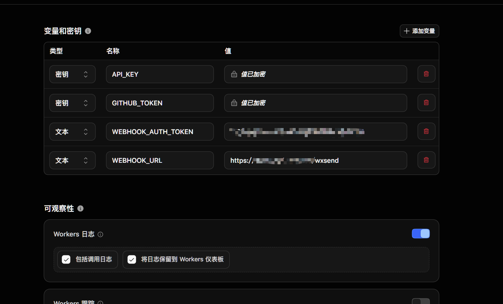

# 部署指南

**点一下按钮就行。** Cloudflare 会把仓库克隆到你的 GitHub 账号、自动创建并绑定 D1 数据库、引导你填几项配置，然后完成构建部署。不需要本地环境，不用命令行，也不用改配置文件。

[](https://deploy.workers.cloudflare.com/?url=https://github.com/GOldX3Cheng/github-release-monitor)

## 前置准备

- GitHub 账号
- Cloudflare 账号（免费版足够）
- 一个能接收 POST 的推送地址（微信 wxpush / 钉钉 / Telegram / 自建服务，见[通知渠道](notification-channels.md)）

> 推送地址暂时没有也行，先部署起来，之后到面板「设置 → 通知渠道」里补。

---

## 一键部署

### 1. 点上面的按钮

按钮地址是：

```
https://deploy.workers.cloudflare.com/?url=https://github.com/GOldX3Cheng/github-release-monitor
```

### 2. 授权 GitHub

第一次使用会让你连接 GitHub 账号。授权后 Cloudflare 会把仓库**克隆到你自己的账号**下（独立副本，不是 fork），后续你可以在自己的仓库里改代码。

### 3. 逐项填写设置页

向导页面上每个字段的含义如下，**只有带「必填」的两项需要想清楚，其余保持默认**：

| 向导项 | 怎么填 |
| --- | --- |
| **Git 存储库** | 默认 `github-release-monitor`。Cloudflare 会在你账号下新建一个仓库并连上，之后你 push 代码就会自动部署 |
| **Select D1 数据库** | **首次部署**：点「+ 新建」，名字默认即可，Cloudflare 会自动创建并绑定。<br>**已经部署过一次**：下拉里**选原来那个库**，千万别点新建，否则新 Worker 指向空库，你原有的仓库列表和设置全看不见 |
| **API_KEY**（必填） | 面板密码。用 `openssl rand -hex 16` 生成，或自己编一串 32 位随机字符。**已经在用的话填原来那个值**，否则旧链接 `?key=` 会失效 |
| **WEBHOOK_URL**（必填） | 推送地址，需能接收 POST JSON。暂时没有就先填 `https://example.com/webhook` 占位，部署完到面板里改 |
| **WEBHOOK_AUTH_TOKEN** | 可留空。渠道要求 `Authorization` 头时才填 |
| **GITHUB_TOKEN** | 可留空。经常撞限额或要监控私有仓库时再填 |
| **部署命令** | 会自动填成 `npm run deploy`（等同于 `wrangler deploy`），不用改 |
| **启用预览构建** | 不用勾 |
| **使用 Cloudflare Access 保护** | **不要勾**。勾了以后你自己访问面板也要先过 Access 登录 |
| **高级设置** | 不用动 |

页面底部若出现一条提示说 API Token 缺少 `artifacts_read` / `artifacts_write` 权限，可以忽略——那是 Workers 构建产物相关权限，本项目用不到，不影响部署。

### 5. 部署并打开面板

点部署，构建约 1–2 分钟。完成后会拿到形如 `https://<worker名>.<你的子域>.workers.dev` 的地址，浏览器打开：

```
https://<你的Worker域名>/?key=<你填的API_KEY>
```

首次访问自动建表，等一秒刷新即可。看到统计卡和「监控项目」列表就通了。

接着在输入框填一个 `作者/仓库名`（例如 `vuejs/core`）点添加，稍后会收到一条基线通知——收到就说明推送链路也是通的。

---

## 已经手动部署过一次，想换成这种方式

不用重建，沿用原有资源即可无缝切换：

1. **Worker 名称保持和现在一致**，这样自定义域名和访问地址都不变
2. **D1 数据库选现有那个库**，不要点「新建」——新建的库是空的，你原来的仓库列表和设置都不在里面
3. `API_KEY` 填**现在正在用的值**，否则旧链接 `?key=` 会失效
4. 部署完成后打开面板，确认仓库列表还在
5. 如果底部配额区块显示「未启用」，说明 `CF_API_TOKEN` / `CF_ACCOUNT_ID` 没跟过来，到「变量和机密」补上即可

> 切换之后 Worker 代码以这个仓库为准。你现在如果还有仓库里没包含的临时改动，先合并进仓库再点部署。

---

## 部署完成后怎么改配置

进 Worker → **设置 → 变量和机密**，可随时增删改，改完点重新部署生效。



想让面板底部出现「Cloudflare 配额」区块，再加两个变量（不配则该区块显示未启用，不影响版本监控）：

| 变量名 | 值 |
| --- | --- |
| `CF_ACCOUNT_ID` | Cloudflare 后台右侧栏可复制 |
| `CF_API_TOKEN` | 单独创建的令牌，权限勾选 **Account → Account Analytics → Read** |

配上后每小时自动巡检，任一指标超 80% 会通过同一个推送渠道告警（同一组风险项只推一次，不刷屏）。也可以点面板的「立即检测」手动跑。

---

## 以后怎么更新

上游更新后，进入你账号下那个仓库，点 **Sync fork → Update branch**。同步产生的提交会自动触发 Cloudflare 重新构建部署。

D1 里的数据不会动，表结构在首次访问时自动补齐。

---

## 排错

| 现象 | 原因 | 处理 |
| --- | --- | --- |
| 按钮点开提示未授权 | 没连 GitHub | 先在 Cloudflare 后台连接 GitHub 账号，再点一次按钮 |
| 构建失败 | 依赖没装好或配置被改动 | 看构建日志；`package-lock.json` 和 `wrangler.toml` 别删 |
| 面板报 `503` | D1 没绑定成功 | 检查 `wrangler.toml` 里 `binding` 是否为 `DB` |
| 面板提示「鉴权失败」 | 打开的是裸域名 | 地址后加 `?key=<API_KEY>` |
| 提示 `Unauthorized` | 没设 `API_KEY` | 到变量和机密里补上并重新部署 |
| 改了变量没生效 | 没重新部署 | 改完点重新部署确认 |
| 添加仓库后收不到通知 | `WEBHOOK_URL` 错，或渠道需要认证头 | 核对地址；点面板「测试」看返回 |
| 部署报 `reached the Workers Free limit of 5 cron triggers` | 免费版每账号最多 5 条 cron | 停掉别的项目里不用的定时，再重新部署 |

---

## 说明

- 免费版每个账号最多 **5 条 cron 触发器**，按「每条 cron 表达式」计数。本项目占 1 条（`*/5 * * * *`）。
- 定时只负责每 5 分钟唤醒一次，真正的检查节奏由面板里的「检查间隔 / 周期时长」控制。
- 数据全在 D1，删 Worker 不会连带删库；要彻底清理需单独删 D1 数据库。
